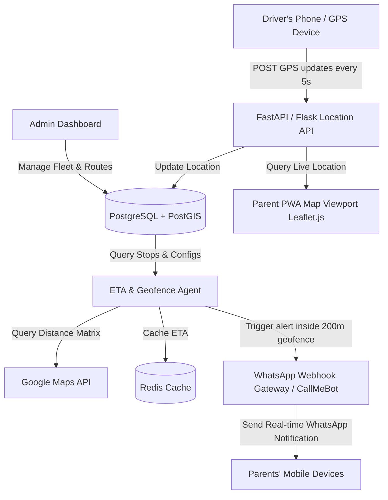

# 🚌 School Bus Tracking System Studio

> Real-time location ingestion, geofenced WhatsApp notifications, distance matrix ETAs, and modular driver/parent dashboards.

[](LICENSE)
[]()

---

### ⚠️ Legal Disclaimer
*This repository contains generic open-source SRE configurations and developer integration templates. Any references to third-party services, APIs, or trademarks (including WhatsApp, Google Maps, AWS, Azure, GCP, or Apple) are for compatibility reference, modular integrations, and educational purposes only. This project is not officially affiliated with, endorsed by, or associated with any of the trademark owners.*

---

## 🏗️ Architecture Flow Diagram



---

## 🚀 Step-by-Step Onboarding & Validation Guide

Follow these SRE steps to deploy, validate, and monitor the School Bus Tracking System:

#### 1. Prerequisites
- [x] Python 3.10+
- [x] Redis Server (for ETA caching)
- [x] PostgreSQL with PostGIS extension (for location geofencing)
- [x] WhatsApp Gateway API Credentials (CallMeBot or WhatsApp Business API)

#### 2. Local Setup
```bash
git clone https://github.com/Pradeeptalari14/tp-school-bus-tracker.git
cd tp-school-bus-tracker
pip install -r requirements.txt
```

#### 3. Database Migration
Enable PostGIS and seed the stops table:
```sql
CREATE EXTENSION IF NOT EXISTS postgis;
CREATE TABLE IF NOT EXISTS stops (
  stop_id SERIAL PRIMARY KEY,
  name VARCHAR(100),
  geom GEOMETRY(Point, 4326),
  parents_phone JSONB
);
```

#### 4. Run Location Ingestion API
```bash
python primary_config/bus_tracker.py
```

---
*Generated by [School Bus Tracking System Studio](https://pradeeptalari14.github.io/portfolio/tools/school-bus-tracker/) — [Talari Pradeep SRE Portfolio](https://pradeeptalari14.github.io/portfolio)*
