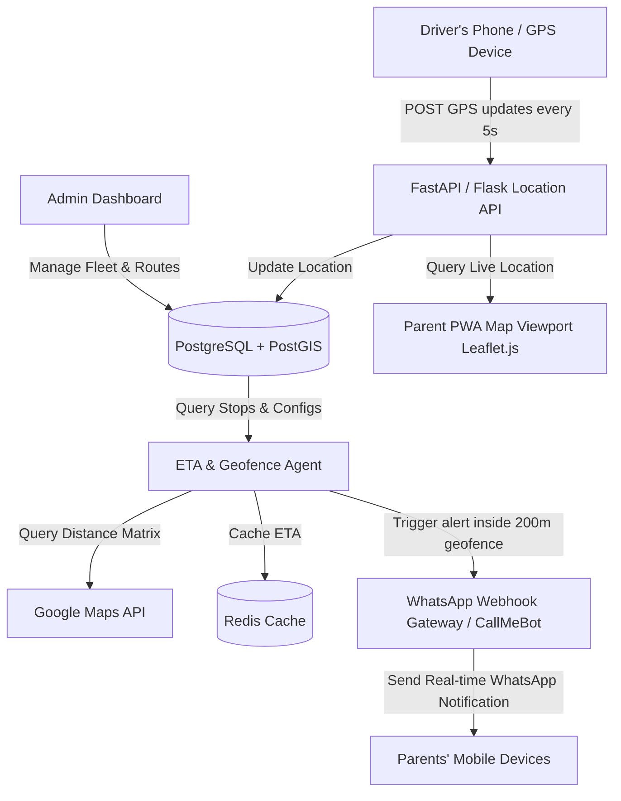

# 🚌 School Bus Tracking System Studio

> Real-time location ingestion, geofenced WhatsApp notifications, distance matrix ETAs, and modular driver/parent dashboards.

---

### ⚠️ Legal Disclaimer
*This repository contains generic open-source SRE configurations and developer integration templates. Any references to third-party services, APIs, or trademarks (including WhatsApp, Google Maps, AWS, Azure, GCP, or Apple) are for compatibility reference, modular integrations, and educational purposes only. This project is not officially affiliated with, endorsed by, or associated with any of the trademark owners.*

---

## 🏗️ Architecture Flow Diagram

---

## 🚀 Implementation & Deployment Plan (Free Tier)

This repository includes a 100% free configuration stack that runs serverless on Google Apps Script, Google Sheets, Leaflet.js, and CallMeBot:

| Component | Technology | Provider | Free Tier Threshold |
| :--- | :--- | :--- | :--- |
| **Backend & Geofence** | Google Apps Script (Serverless) | Google | 90 mins/day execution time, 20,000 fetch calls/day |
| **Database Store** | Google Sheets | Google | 5 million cells |
| **WhatsApp Dispatch** | CallMeBot Webhook API | CallMeBot | Unlimited basic messages (<1000/day recommended) |
| **Frontend Maps** | Leaflet.js + OpenStreetMap | Open-Source | Unlimited (no API keys required) |
| **Web Hosting** | GitHub Pages / Netlify / Vercel | Vercel/Netlify | Unlimited bandwidth for personal/hobby use |

### Step-by-Step Deployment

#### Phase 1: Database & Sheet Setup
1. Create a blank Google Sheet at [sheets.new](https://sheets.new).
2. Create two sheets named `Live_Location` and `Stops`.
3. Set the column headers:
   - `Live_Location`: `Timestamp`, `Bus ID`, `Latitude`, `Longitude`, `Status`
   - `Stops`: `Stop ID`, `Stop Name`, `Latitude`, `Longitude`, `Parents Phone Numbers`
4. Seed your stop data in the `Stops` sheet (e.g. `stop_1`, `Main Street Corner`, `12.971598`, `77.594562`, `+919876543210`).

#### Phase 2: Ingestion Server (Google Apps Script)
1. In your Google Sheet, navigate to **Extensions ➔ Apps Script**.
2. Paste the contents of `primary_config/bus_tracker_gas.js` and `primary_config/sheets_setup.js`.
3. Run the `setupSheetDatabase` function once to format your sheets.
4. Click **Deploy ➔ New Deployment ➔ Web App**. Set Access to *"Anyone"*, then execute as *"Me"*.
5. Copy the generated Web App URL.

#### Phase 3: WhatsApp Alert Setup
1. Add CallMeBot (`+34 644 97 50 14`) to your contacts.
2. Send WhatsApp message: `I allow callmebot to send me messages`.
3. Copy the API key returned by the bot and paste it into the `CALLMEBOT_API_KEY` variable in your Apps Script. Redeploy your Web App.

#### Phase 4: Host Client Apps
1. Host `primary_config/parent_pwa.html` on GitHub Pages, Netlify, or Vercel for free.
2. Update the parent map script with your Apps Script Web App URL to retrieve real-time location.

---
*Synchronized with [School Bus Tracking System Studio Studio](https://pradeeptalari.me/tools/school-bus-tracker/) & [Repository Learning DAG](https://pradeeptalari.me/tools/repo-learning/) — [Talari Pradeep Portfolio](https://pradeeptalari.me)*
